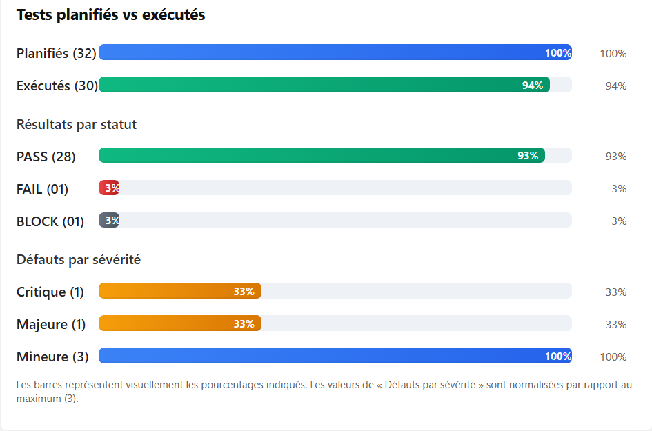

# Rapport de clôture de la Campagne de Test (PV de Recette)

> **Document**: Procès-Verbal de Recette — Quiz Game Sprint 1  
> **Référence**: QA-PV-2025-11  
> **Version**: 1.3  
> **Date**: 30/11/2025  
> **Auteur**: Ahmed Hajjej & Skander Hakouna  
> **Diffusion**: `QA_Bundle/SOUMISSION_QA_QUIZ_GAME/03_EXÉCUTION_TESTS` & `QA_Bundle/AHMED/05_Reports`
> **Responsables QA**: Ahmed Hajjej & Skander Hakouna

---

## Etape 1 : Objectif du document
Ce procès-verbal synthétise l'ensemble des activités de test menées durant le Sprint 1 afin de statuer sur la conformité de l'application Quiz Game pour la démonstration interne. Il reprend la portée, les métriques, les défauts, les leçons et les recommandations nécessaires à la décision de mise à disposition.

## Etape 2 : Aperçu de l'application
Quiz Game est une application web interactive permettant à un utilisateur connecté de choisir une catégorie (Computer Science, Mathematics, General Knowledge, Sports), de répondre à un quiz et de consulter son classement global. Les fonctionnalités livrées ce sprint sont :
- Inscription / Connexion / Déconnexion sécurisées.
- Sélection de catégorie, déroulé complet du quiz, affichage du score et sauvegarde du meilleur résultat.
- Leaderboard dynamique avec classement par catégorie et total.
- API Node/Express + MongoDB pour la gestion utilisateurs, questions et scores.
L'objectif de la campagne est de valider ces parcours critiques et les exigences non-fonctionnelles prioritaires (performance UI, charge API, hygiène sécurité).

## Etape 3 : Portée du test
1. **Portée** — Tests fonctionnels couvrant les modules : Login, Register, Logout, Sélection et Exécution d'un Quiz, Sauvegarde des scores, Leaderboard. Les tests NFR réalisés couvrent performance (Lighthouse), charge API (k6) et sécurité passive (OWASP ZAP).
2. **Hors portée** — Tests de compatibilité mobile native, stress tests prolongés, audit sécurité actif, fonctionnalités sociales (badges, commentaires) non livrées.
3. **Fonctionnalités non testées** — Scénarios dépendant d'améliorations futures : accessibilité avancée (niveau AAA) et pagination/scalabilité massives. Leur absence est justifiée par des dépendances techniques non encore disponibles.

## Etape 4 : Métriques
### 4.1 Vue synthétique
| Indicateur | Valeur |
|------------|--------|
| Cas de test planifiés | 32 (24 fonctionnels, 8 NFR) |
| Cas de test exécutés | 30 (94%) |
| Cas PASS | 28 |
| Cas FAIL | 1 (TC-QUIZ-003) |
| Cas BLOCK | 1 (TC-DATA-004) |
| User stories couvertes | 11/11 (100%) |
| Défauts ouverts | 2 (1 majeure, 1 critique) |
| Défauts fermés durant le cycle | 3 |

### 4.2 Tableaux et visuels

### 4.3 Répartition par module
| Module | Cas exécutés | Pass | Défauts associés | Commentaire |
|--------|--------------|------|------------------|-------------|
| Authentification | 6 | 6 | 0 | Parcours Login/Register/Logout validés. |
| Quiz | 7 | 6 | DEF-001 | Mélange aléatoire à corriger. |
| Leaderboard | 3 | 3 | 0 | Tri décroissant confirmé. |
| Données & Scores | 5 | 4 | DEF-002 | Validation d'index à ajouter. |
| NFR | 9 | 9* | Alertes headers & LCP > 3s (WARN, ZAP 29/11). |
\* Accessibilité avancée et scalabilité reportées (voir Etape 3).

## Etape 5 : Types de test
- **Fonctionnels manuels** : parcours utilisateur bout en bout (authentification, quiz, leaderboard).
- **Tests API** : Postman/SuperTest pour `/api/users/*` et `/api/questions`.
- **E2E automatisés** : scripts Cypress ciblant login → quiz → leaderboard.
- **Tests de performance UI** : Lighthouse (profil mobile 4G).
- **Tests de charge API** : k6 (50 VUs / 2 minutes) sur GET questions.
- **Tests de sécurité passifs** : OWASP ZAP (headers manquants, cookies non sécurisés).

## Etape 6 : Environnement de test et outils
| Environnement | Description | Objectif |
|---------------|-------------|----------|
| DEV Local | Node 20.x, Angular CLI 18.2, MongoDB locale, `.env` dev | Développement & smoke tests. |
| TEST Partagé | Backend sur VM + MongoDB Atlas sandbox + build Angular prod | Campagne QA, NFR. |

| Outil | Usage |
|-------|-------|
| Cypress 13 | Parcours E2E automatisés. |
| Postman / Newman | Collections API réutilisables. |
| k6 | Charge API. |
| Lighthouse | Indicateurs LCP, TTI, scores perf. |
| OWASP ZAP | Scan passif sécurité. |
| Sheets structurées | Suivi cas de test et métriques quotidiennes. |

## Etape 7 : Leçons apprises
1. **Disponibilité des environnements** — Anticiper la configuration MongoDB (`.env`) pour éviter les blocages RUN-FT-001.
2. **Données de test** — Centraliser le script `addQuestions.js` et automatiser son exécution dans les pipelines.
3. **Suivi temps réel** — La visualisation des métriques dans Sheets structurées a facilité les décisions GO/NO-GO.

## Etape 8 : Recommandations
1. Implémenter l'algorithme de mélange Fisher-Yates côté frontend et ajouter un test unitaire (résolution DEF-001).
2. Sécuriser la route PATCH score avec validation stricte (0–3) et tests SuperTest (résolution DEF-002).
3. Optimiser la performance perçue : pré-chargement CSS, compression Brotli, revue des assets images.
4. Ajouter les en-têtes `Content-Security-Policy`, `X-Frame-Options`, `X-Content-Type-Options`, `Strict-Transport-Security` et configurer les cookies `Secure/SameSite` (cf. ZAP 29/11/2025).
5. Planifier une itération dédiée aux exigences Should/Could (accessibilité avancée, pagination leaderboard, tests de scalabilité).

## Etape 9 : Meilleures pratiques
- **Seed contrôlé** — Utiliser des jeux de données versionnés et rejouables avant chaque campagne.
- **Défauts traçables** — Centraliser les incidents (DEF-00x) avec lien direct vers les cas de test impactés.
- **Definition of Done QA** — Inclure les validations Cypress/Postman dans le pipeline CI pour prévenir les régressions.

## Etape 10 : Critères de sortie
- 100% des user stories MUST HAVE validées ✔️
- 0 défaut bloquant restant ✔️
- Défauts majeurs/critiques identifiés et plan d'action assigné ✔️
- Rapports NFR fournis (perf/charge/sécurité) ✔️
- Documentation QA consolidée (`02.2_DOSSIER_QA_COMPLET.md`, présents rapports) ✔️

## Etape 11 : Conclusion / Signature
**Décision** : GO conditionnel pour démonstration interne, mise en production soumise à la fermeture de DEF-001 et DEF-002, à la diminution du LCP < 3s et à la mise en place des en-têtes sécurité recommandés.  
**Signatures** :
- QA Lead : ______________________  
- Product Owner : __________________

## Etape 12 : Définitions, acronymes et abréviations
| Terme | Signification |
|-------|---------------|
| LCP | Largest Contentful Paint |
| TTI | Time To Interactive |
| NFR | Non-Functional Requirement |
| PV de Recette | Procès-Verbal de Recette |
| VU | Virtual User (k6) |
| CSP | Content-Security-Policy |
| DoD | Definition of Done |
| RUN-FT-00x | Identifiant des sessions d'exécution fonctionnelle |

---
**Fin du rapport de clôture — Campagne de Test Sprint 1**

